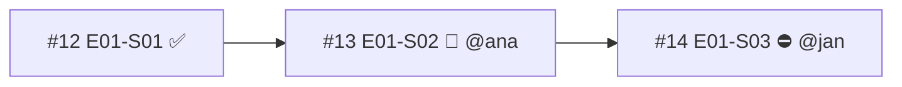

# Report templates

Use after classifying nodes and conflicts. Follow `references/rules.md`. Lead with the conflicts that waste work, then what is safe to pick. Keep the full graph in collapsible detail.

## Full report

```markdown
⛔ `mk-check-blockers` — {c} conflicts ({h} need a human now), {s} safe to start, {w} waiting on blockers.
{Scope: sources, --epic, read time; disclose disabled labels, native relations not read, truncation, and nodes whose state is Unknown.}

**Conflicts**
1. ⛔ C2a — #{dependent} {id} ({owner}) started while blocker #{blocker} {id} is free. → {next action}
2. ⚠️ C6 — #{pr1} and #{pr2} both change `{path}` (+{n} more). → merge #{pr1} first, #{pr2} rebases.
3. …

**Safe to start** (for {login})
1. #{n} {id} — {title}; unlocks {k}. → `om-auto-fix-issue {n}`
2. …

**Critical path**: #{a} → #{b} → #{c} ({len} items; {in flight}/{free} on it).


{One sentence on what the diagram shows. Include only the in-flight and conflicting subgraph, at most ~15 nodes.}

<details><summary>Full graph ({n} items)</summary>

| Item | State | Owner | Blocked by | Blocks | Findings |
|---|---|---|---|---|---|
| [#{n}]({url}) {id} — {title} | {state}{ (possibly stale)} | {login or —} | #{a} ✅, #{b} ⏳ | #{x} | C2a, C7 |

</details>

{🏷️ line when label drift exists and --sync-labels was not passed: "{k} issues carry a stale or missing `blocked` label; run with --sync-labels to fix."}

Next: {first next action as a skill invocation, or none}
```

Order of *Conflicts*: ⛔ before ⚠️ before 🏷️; inside a severity, backlog order. At most eight lines; the rest goes into the details table. Omit any section that is empty — when there are no conflicts, say so in the headline (`✅ no conflicts`) and lead with *Safe to start*.

## Gate mode (`--issue`)

```markdown
{✅ clear | ⏳ wait | ⛔ conflict} `mk-check-blockers` — #{n} {id}: {one-sentence reason}.
{wait: the non-resolved blockers with their state and owner, one line each.}
{conflict: the finding, its owner, and what has to happen first.}

Verdict: {clear|wait|conflict}
Blocked by: #{a} #{b}
Next: {om-auto-fix-issue {n} | none}
```

Three to six lines before the contract lines. Omit `Blocked by:` on `clear`.

## JSON (`--format json`)

One object:

`{"scope": {...}, "coverage": [...], "nodes": [{"issue", "id", "state", "stale", "owners", "blockedBy", "blocks", "prs", "findings"}], "conflicts": [{"rule", "severity", "issues", "owners", "evidence", "next"}], "safeToStart": [{"issue", "id", "unlocks", "next"}], "criticalPath": [...], "labelDiff": [{"issue", "add", "remove"}]}`

In gate mode, add `"verdict"` and `"blockedBy"` at the top level; the text contract lines are still printed after the JSON.

A blocker report states what the tracker shows about order and ownership, not code quality or estimates; never infer either from the graph.
